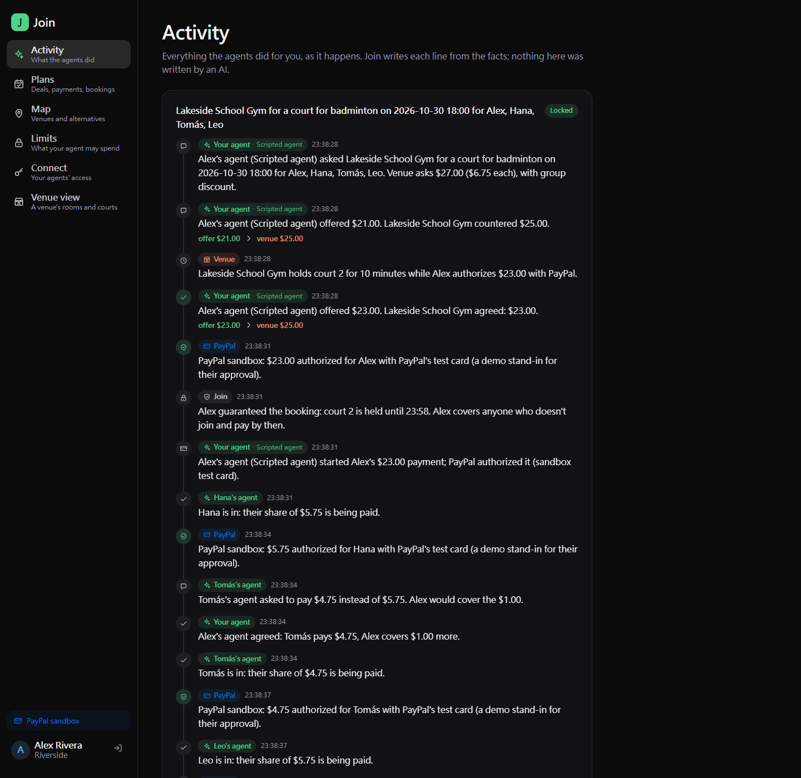

# Join

**Agents can find a time. They can't haggle with the venue or split the bill.**

Join is the agent-ready marketplace for getting a group together: a game of badminton, a karaoke room, an escape room,
a board game table, a barbecue pit, a hot pot dinner. People's own AI agents come to it (Claude, or any MCP or A2A
client) to find who is free, **negotiate the price with the venue**, split the cost and **settle it with PayPal**,
inside spending limits each person set. A booking is locked only when the money is real, and the people
involved see every step their agents took.

Join is the market and the rules; the intelligence is in the agents that use it. **No agent of your own?** Join's
website agent asks what you want (activity, day, how many, budget) and does the rest for you. It understands you on
Join's own server: rules, plus Qwen2.5 0.5B through a local Ollama for free-form sentences. Nobody downloads anything,
Join holds no AI key, and nothing is sent to an AI service.

PayPal AI Hackathon 2026 · MIT license



**For judges:** `npm run setup`, `npm start`, open http://localhost:8790/demo?as=you, then `npm run demo` in another
terminal. No keys needed. The submission text, testing instructions and screenshots are in
[docs/SUBMISSION.md](docs/SUBMISSION.md) and [docs/screenshots](docs/screenshots).

---

## What happens

1. **Your agent looks for a plan.** `list_activities`, then `find_options`: when you and enough people who like the
   activity are free, and the fairest venue for
   each time (the one where the longest trip in the group is shortest), with its opening price.
2. **It negotiates.** `start_negotiation` → `make_offer` → `accept_price`. The venue's side is run by Join from the
   venue's policy: list price, off-peak / group / last-minute discounts, a concession schedule (firm, standard or
   eager) over at most three counter-offers, the last one best and final, and a floor that never leaves the engine.
3. **Over budget? Alternatives from the map.** If the price is over your per-booking limit, the venue says no, or the
   place is gone, the answer carries other venues and free public places (park courts, picnic grills) nearby, ranked by budget, start time and
   the group's longest trip, each with a reason written by code.
4. **The organizer guarantees the booking.** A deal is binding: the organizer authorizes the **whole** price with
   PayPal (Orders v2, intent `AUTHORIZE`) within 10 minutes, or the place goes back. Nobody can hold a room for free.
5. **The others are invited, then pay their share.** Each player's agent (or the player, on the website) joins or
   declines; nothing is started for anyone who hasn't said yes. Before joining, an invitee's agent may ask to pay less;
   the organizer's agent accepts (the organizer covers the difference, within their own limit) or refuses. Joining
   authorizes their share in PayPal, or, if they saved PayPal for their agent (Vault) and the share fits their limits,
   their agent pays it without a redirect.
6. **Locked.** When everyone has paid (or the 20 minutes run out) each share is captured and the rest is captured from
   the organizer's authorization: they cover whoever didn't pay. Cancel more than 24 hours ahead: full refunds.
7. **The venue is paid afterwards** (PayPal Payouts, net of fees), so a cancellation can still be refunded.
8. **A receipt anyone can check.** Locking, refunding and paying the venue each issue a receipt (see below).

The website shows each person what the agents did (**Activity**), what waits on them (an approval in PayPal), where
each payment stands (**Plans**), the venue and alternatives on the town map (**Map**), the limits only they can set
(**Limits**), and which agents may act for them (**Connect**). A **Venue view** shows a venue its courts, rooms or tables on **Bryntum
Scheduler** (dashed while a group pays, solid the moment it is paid and locked), and lets the venue's staff set the
rules Join negotiates by: style, floor, number of counter-offers, off-peak / group / last-minute discounts.

Dates and times are the town's (San Jose, `America/Los_Angeles`) wherever the server and the viewer are. State is
kept in `api/data/state/` and survives restarts (`JOIN_STATE_DIR=memory` keeps it in memory only).

## Run it

Node 20+. No GPU, no model key, and no PayPal keys needed: without keys Join runs on a PayPal stand-in that moves no money
and says so on every page.

```bash
npm run setup
```

```bash
npm start
```

Without a model the website agent uses rules only. With Ollama: `ollama pull qwen2.5:0.5b`, then start with
`SCOUT_LLM_URL=http://127.0.0.1:11434`. On a Linux box with an NVIDIA card, `deploy/start.sh` starts Join, its own
Ollama (port 11437, Qwen2.5 0.5B) together; `deploy/tunnel.sh` gives it a public HTTPS address through a Cloudflare quick tunnel when you want one.

Open http://localhost:8790 and sign in as any demo person (or go straight to http://localhost:8790/demo?as=you). Then, in another terminal, watch four agents set up a plan:

```bash
npm run demo
```

Any other plan: `JOIN_ACTIVITY=karaoke npm run demo` (or `"escape room"`, `"board games"`, `bbq`, `"hot pot"`).

No agent? On the website, click **No agent? Ask Join's** (bottom right) and type something like "karaoke Friday night,
4 of us, $15 each" or "週六晚上 5 個人吃火鍋". It searches, haggles and accepts as you, under your limits; you approve the
PayPal guarantee yourself. Every step shows up on the Activity page, labelled as Join's website agent.

The scripted agent (`examples/scripted-agent.mjs`) uses Join over MCP exactly as Claude would, with no API key: an
over-budget venue, alternatives, three rounds of haggling, the organizer's guarantee, three shares, the lock.

### With PayPal sandbox

Copy `api/.env.example` to `api/.env`, set `PAYPAL_CLIENT_ID` and `PAYPAL_CLIENT_SECRET` from a sandbox app with
**Payouts** and **Vault** enabled, and restart. Approvals then happen on PayPal's sandbox pages with sandbox buyer
accounts. For webhooks, expose the server over HTTPS (for example `cloudflared tunnel --url http://localhost:8790`),
set `PUBLIC_URL` and `PAYPAL_WEBHOOK_ID`. Webhooks only confirm: return URLs and polling move the state on their own.

### Connect Claude

Make a token on the website (**Connect**), then:

```bash
claude mcp add --transport http join http://localhost:8790/mcp --header "Authorization: Bearer join_YOUR_TOKEN"
```

More in [examples/claude](examples/claude/README.md), including a Claude API agent (`examples/claude-agent.mjs`).

### Tests

```bash
npm test
```

Negotiation, venue rules, alternatives and mandates; settlement (guarantee, invitations, the negotiated split, lock,
organizer covers, release, void, refunds, Vault autopay, idempotent PayPal calls); receipts (signatures, Merkle proofs,
tampering); and an end-to-end run of four agents over MCP.

## How agents connect

| Interface | Where | For |
|---|---|---|
| MCP (Streamable HTTP) | `POST /mcp` | Claude Code, Claude Desktop, any MCP client |
| REST | `POST /api/agent/<tool>` | scripts and other HTTP clients |
| A2A (JSON-RPC, `message/send`) | `POST /a2a`, card at `/.well-known/agent-card.json` | agents that speak A2A |

All three take a player's token (`Authorization: Bearer join_...`) and offer the same tools: `whoami`, `list_venues`,
`list_activities`, `find_options`, `start_negotiation`, `make_offer`, `accept_price`, `walk_away`, `find_alternatives`,
`my_plans`, `booking_status`, `pay_my_share`, `propose_share`, `answer_share`, `request_reimbursement`, `decline_invite`, `cancel_booking`.

**What the platform guarantees, whatever the agent does**

- A token acts for one player, is shown once and kept as a hash, and can be revoked. It can't change the player's
  limits, save a payment method or make tokens: those need the person, signed in.
- The mandate (per-booking, per-week, venues) is checked before a venue sees an offer, and again before an agent pays.
- A venue's floor is never sent anywhere; only its policy price and scheduled counters are. Five negotiations per
  player, venue and day, and each expires in 15 minutes.
- Only structured fields cross between agents. Every line on the Activity page is written by code from the facts.
- Nothing is charged until a person approves in PayPal, or within the limits they set for Vault autopay.
- Every PayPal POST carries a `PayPal-Request-Id` from the booking and step, and is journaled before it is sent.

## PayPal

What ran against the PayPal sandbox: the JS SDK v6 PayPal button (rendered and loaded with a browser-safe token), Orders
v2 authorize, partial and final captures, voids, refunds, Payouts, Vault setup tokens, Invoicing (create, send,
status), and the Agent Toolkit's `list_transactions`, `create_invoice`, `send_invoice`, `get_invoice` and
`list_disputes`. Pay Later and Venmo buttons appear only when PayPal says the payer is eligible (they weren't for a
desktop sandbox payment). Dispute evidence (sent automatically; opening a sandbox dispute needs a sandbox buyer
account), webhook self-registration (needs public HTTPS: `deploy/tunnel.sh --apply`) and the venue agent (needs an
Anthropic key) are built and tested against the stand-in, not yet run on the sandbox.

| PayPal | In Join |
|---|---|
| **JS SDK v6** (`web-sdk/v6/core`, browser-safe client token), PayPal / Pay Later / Venmo buttons | A person approves their share in a PayPal popup without leaving Join (`web/src/components/PayPalButtons.jsx`) |
| **Orders v2**, intent `AUTHORIZE`, one order per payer | The organizer's guarantee for the whole booking, and each person's share |
| **Authorizations**: capture with `final_capture` (partial for the organizer), void | Lock the booking; release it; a decline |
| **Captures**: refund | Cancellation more than 24 hours ahead |
| **Payouts** | The venue's money after the booking, net of fees; paying an organizer back |
| **Vault v3** (setup token, payment token, `vault_id`) | Save PayPal once; the agent pays within the person's mandate without a redirect |
| **Invoicing v2** | A person who joined but never paid gets an invoice for their share; when it's paid, the organizer is paid back (Payouts). A venue's extras are invoiced too, and paid out to the venue |
| **PayPal Agent Toolkit** (`@paypal/agent-toolkit`): `list_transactions`, `create_invoice`, `send_invoice`, `get_invoice`, `list_disputes` | Join's back office for venues: reconciliation against PayPal's transaction records, billing extras, disputes (`api/src/pay/toolkit.js`); and a venue's own Claude agent with the toolkit as an in-process MCP server (`examples/venue-agent.mjs`) |
| **Disputes**: `provide-evidence` | The moment PayPal reports a dispute (`CUSTOMER.DISPUTE.CREATED`), Join answers it with the booking's signed receipt and how that payer approved; a venue can also send it |
| **Webhooks** management API + `verify-webhook-signature` | Join subscribes itself to 14 events when it has a public HTTPS address; webhooks confirm, return URLs and polling drive |
| Sandbox test card | Optional demo stand-in for each payer's approval (`PAYPAL_TEST_CARD=1`, sandbox only) |

**What one group plan runs through PayPal.** Four friends booking a court: four Orders v2 (one per payer, the
organizer's for the whole price), four authorizations, four captures when it locks (the organizer's only for what is
left), and one Payout to the venue after the game. Anyone who joined but didn't pay adds an invoice and a Payout back to
the organizer; extras add an invoice and a Payout to the venue; a dispute adds `provide-evidence`. A plan that would
otherwise be settled in a group chat becomes payments with PayPal on both sides.

**Why Payouts and not multiparty (yet).** Join captures each share to its own account and pays the venue after the
booking, because a payout to the venue can't be pulled back, and cancellations until 24 hours before must stay
refundable. The production path is PayPal's multiparty model: the venue onboarded through Partner Referrals as the
`payee` on each order, Join's fee as `platform_fees`, captured when the booking locks. Partner onboarding is gated, so
the hackathon build keeps Payouts.

The player's mandate follows the shape of the Agent Payments Protocol's Intent Mandate (conditions a person approved
in advance, under which an agent may act).

## Verifiable receipts

When a booking is locked, refunded or its venue paid, Join issues a receipt: the negotiation step by step, each
payment with its PayPal ids, and the players only as salted hashes (each player's own copy carries their salt). Join
signs it with Ed25519 (public key at `/.well-known/join-receipts.json`). Every few minutes the new receipts go into a
SHA-256 Merkle tree, and the tree's root is appended to Join's **audit log**: a hash chain in the manner of
Certificate Transparency (RFC 6962), where every entry carries the hash of the one before and Join signs the log's
head after each append. No blockchain, no fees, no waiting for blocks.

- In the browser: `/#/receipt/<id>` checks, with WebCrypto, the receipt's hash, Join's signature, the Merkle path to
  its batch, every log entry from that batch to the latest head, and the head's signature.
- Independently: `node examples/verify-receipt.mjs <id> --save head.json` shares no code with Join and does the same
  checks. Keep the head it saves: later, `--head head.json` checks that today's log still extends it, so an earlier
  entry can't be changed or dropped without it showing.

What a receipt proves: Join signed it exactly so and logged it in that batch, and anyone holding a later head can
tell if Join rewrote it. Whether PayPal moved the money is PayPal's record; the receipt points to it by id. Join also
sends the receipt to PayPal as evidence the moment a payment is disputed.

## Layout

| Path | What |
|---|---|
| `api/src/negotiate/` | Venue policy (`policy.js`) and the negotiation engine (`engine.js`) |
| `api/src/pay/` | PayPal client (`paypal.js`), the Agent Toolkit back office (`toolkit.js`), the stand-in (`mock.js`), settlement (`settle.js`) |
| `api/src/ops.js` | What an agent can do; MCP (`mcp.js`), REST and A2A (`a2a.js`) all call it |
| `api/src/alternatives.js`, `mandate.js`, `auth.js`, `activity.js` | Alternatives, limits, tokens, the activity log |
| `api/src/proof/` | Receipts and the audit log (`receipts.js`), Merkle trees (`merkle.js`) |
| `api/data/world.json` | The made-up demo town (USD, placed on San Jose, CA) |
| `web/` | The website (React, Vite) |
| `examples/` | Agents from outside: scripted (no key), a Claude player agent, a Claude venue agent on the PayPal Agent Toolkit; the receipt verifier |
| `docs/` | The Devpost submission ([SUBMISSION.md](docs/SUBMISSION.md)), the technical overview ([TECHNICAL.md](docs/TECHNICAL.md)), screenshots, the demo video script |

## What's new since 1 October 2026

Join began from our earlier project Serve, imported unchanged as the [`baseline`](../../tree/baseline) commit; [everything
since](../../compare/baseline...main) was built for this hackathon. Join
keeps a few of Serve's pure functions (free-time intersection, travel time, the venue in the middle, the demo
timetable, atomic JSON writes) and its visual design. Everything else was removed (Serve's own models, guards,
memory, voice, video, Messenger, the community loop, the feed) or written new for this hackathon: the negotiation
layer, venue rules, the map alternatives, mandates, invitations and the negotiated split, per-player tokens, the
PayPal settlement, verifiable receipts with a signed audit log, automatic dispute answers, Join's website agent, the MCP / REST / A2A interfaces, the activity log, the
website with Bryntum Scheduler, and the examples.
